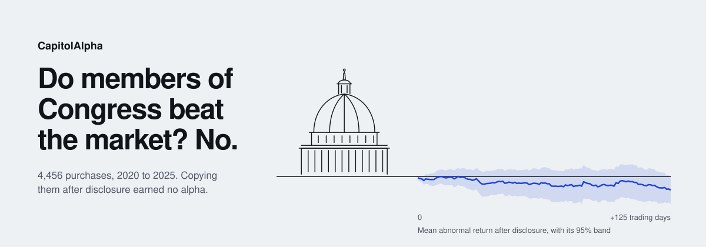
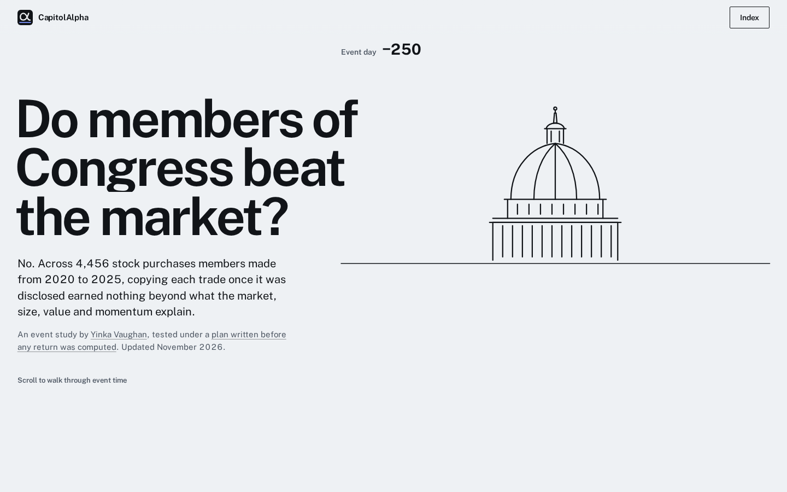
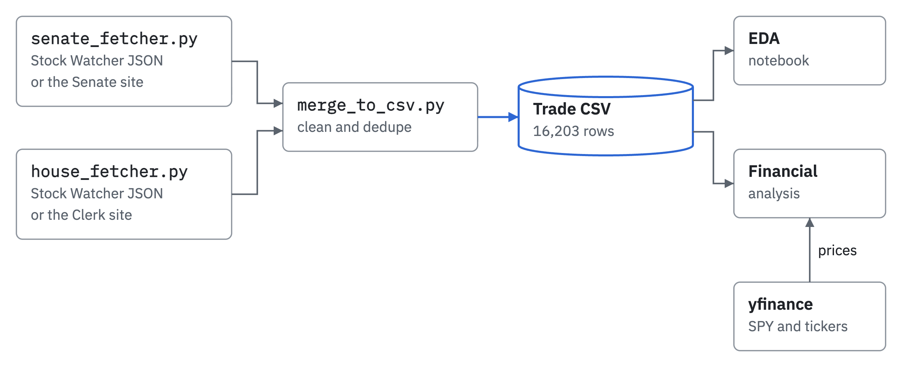

<picture>
  <source media="(prefers-color-scheme: dark)"  srcset="assets/banner-dark.svg"  type="image/svg+xml">
  <source media="(prefers-color-scheme: light)" srcset="assets/banner-light.svg" type="image/svg+xml">
  <source media="(prefers-color-scheme: dark)"  srcset="assets/banner-dark.png">
  <source media="(prefers-color-scheme: light)" srcset="assets/banner-light.png">
  
</picture>

[](https://github.com/Builder106/capitol-alpha/actions/workflows/ci.yml)
[](https://capitolalpha.vercel.app)
[](https://www.python.org/)
[](https://playwright.dev/python/)
[](#license)
[](https://www.wesleyan.edu/qac/)

> **Do members of Congress beat the market?** An event study of 4,456 congressional stock purchases, 2020 to 2025, on CRSP data. Copying them once they were disclosed earned no four-factor alpha.

<p align="center">
  
</p>

## What is CapitolAlpha?

Members of Congress have to disclose their stock trades. CapitolAlpha collects House and Senate disclosures to test a popular claim: that those trades beat the market. It compares each purchase's return with the return predicted by a four-factor model, starting when the public could first see the trade.

In the primary test, the answer is no. A portfolio that buys every disclosed purchase on the first trading day after disclosure and holds it for 62 trading days earns a four-factor alpha of -1.63% a year (t = -0.66, p = 0.51). This test was fixed in advance. The 95% band around average abnormal returns after disclosure covers zero on each of the first 126 trading days, and seven robustness checks also find no significant alpha.

**Site:** [capitolalpha.vercel.app](https://capitolalpha.vercel.app) walks through the study in event time.

## Project history

CapitolAlpha started in spring 2025 as a semester project for **QAC 420 (Data for Good)** at Wesleyan University. That version reported that purchases beat the S&P 500. An audit in November 2026 found it did not hold: a text filter dropped every House purchase, leaving about 220 Senate trades; only the 50 most-traded tickers had prices; returns started on the trade date; and the "alpha" assumed a beta of one. The [journal](JOURNAL.md) records the details.

The redo follows a plan committed before any new return was computed: [`docs/specs/event-study.md`](docs/specs/event-study.md). After seeing the first results, the calculation was changed to remove factor exposure only. The plan names the betas to estimate but does not say how to treat the pre-event intercept, so this was a post-results choice, and the event-level results are exploratory; the primary portfolio test was fully specified in advance. The first run's numbers are still printed and reported. An outside review later found that the portfolio entered a day late after weekend and holiday disclosures; correcting that moved the primary alpha from -1.82% to -1.63% a year.

The spring 2025 course write-ups are kept as a record and are superseded by the event study: [abstract](docs/abstract/abstract.pdf), [final reflection](docs/Final_Reflection/Final_Reflection.pdf), [statistics](docs/statistics/statistics.pdf).

## Key findings

Full tables: [`docs/results/event-study.md`](docs/results/event-study.md) and [`docs/results/disclosure-lag.md`](docs/results/disclosure-lag.md).

| Question | Result |
| --- | --- |
| Copy portfolio from disclosure, 62-day hold (primary) | Alpha -1.63% a year, t = -0.66, p = 0.509, 3,942 House purchases |
| Same portfolio, 20 and 125 days | 2.08% (p = 0.520) and -1.67% (p = 0.470) |
| Mean CAR after disclosure, days 20, 62 and 125 | 0.00%, -0.34%, -0.68%; smallest Holm-adjusted p = 0.343 |
| Mean CAR after the trade date | No horizon significant after Holm correction |
| Seven robustness checks and the five-factor model | All insignificant; largest is amount-weighted, 7.19% a year (t = 1.45) |
| Disclosure delay (House) | Median 13 days; 69 of 1,965 filings listed a trade reported more than 45 days after it |

Sample: 5,137 purchases after the plan's rules, of which 4,456 match CRSP common stock on the trade date. ETFs, funds, ADRs and over-the-counter foreign shares are excluded and listed with reasons.

One exploratory pattern: members tend to buy stocks that had been beating the factor model before the trade.

## Pipeline

Senate and House filings are fetched separately and merged into one 16,203-row trade CSV. Both notebooks read that CSV, and the financial one also pulls market prices.

<picture>
  <source media="(prefers-color-scheme: dark)" srcset="assets/diagrams/pipeline-dark.png">
  
</picture>

[Edit the diagram](assets/diagrams/pipeline.html).

[`run_pipeline.py`](run_pipeline.py) runs data extraction through the modules in [`pipeline/`](pipeline/). The [`tests/`](tests/) directory covers the extractors and data cleaning.

## Reproducing the analysis

```bash
uv sync --group dev
uv run playwright install chromium

python -m pipeline.run_pipeline --use-official
uv run python -m pipeline.disclosure_lag

uv run --with "psycopg[binary]" python -m pipeline.crsp --user WRDS_USER --out-dir DIR
uv run python -m pipeline.run_event_study --data-dir DIR
uv run python -m pipeline.site_figures --data-dir DIR

uv run pytest
```

The event study needs a WRDS account with CRSP access. `pipeline.crsp` reads the password from your own `~/.pgpass`. CRSP data is licensed, so the extract in `DIR` stays out of the repository; `pipeline.site_figures` writes only aggregates to `site/data/figures.json`.

Pipeline options (`--fresh`, `--senate-only`, `--house-only`) are documented in [`pipeline/README_PIPELINE.md`](pipeline/README_PIPELINE.md).

## Limits

- **House only for the primary test.** The Senate records in the snapshot carry no disclosure date, so Senate purchases appear only in the trade-date checks.
- **Late filings are right-censored.** The trade snapshot dates from April 2026, so some filings for late 2025 trades are missing.
- **Prices end on 31 December 2025.** Later purchases have shorter horizons, so fewer events reach day 125.
- **A null is not proof of no information.** The test asks whether a public follower could profit. It says nothing about what any member knew.

## Tech stack

- **Python 3.11+** with `pandas` and `numpy` for the event study, plus `scipy`, `matplotlib` and `seaborn` in the notebooks
- **CRSP through WRDS** for daily returns, and Kenneth French's data library for the factors
- **Playwright** for browser automation on JavaScript-rendered disclosure sites
- **pdfplumber** for House PTR PDF table extraction
- **yfinance** in the spring 2025 notebooks only
- **pytest** for unit tests on the fetchers and merge step
- **Jupyter** for the EDA and financial-analysis notebooks
- **GSAP** and Glaxnimate-drawn SVG for the site

## Acknowledgments

- The **Wesleyan QAC** for the *Data for Good* course frame and the methodological feedback through the semester.
- [`timothycarambat/senate-stock-watcher-data`](https://github.com/timothycarambat/senate-stock-watcher-data) as the JSON fallback when official scraping fails.
- The U.S. Senate Office of Public Records and the Office of the Clerk of the House for publishing the disclosure data that makes this analysis possible at all.

## License

Code released under the [MIT License](LICENSE). The underlying disclosure filings are public records in the public domain; the dataset assembled here (`data/legislative_trades.csv`) is released under the same terms.
